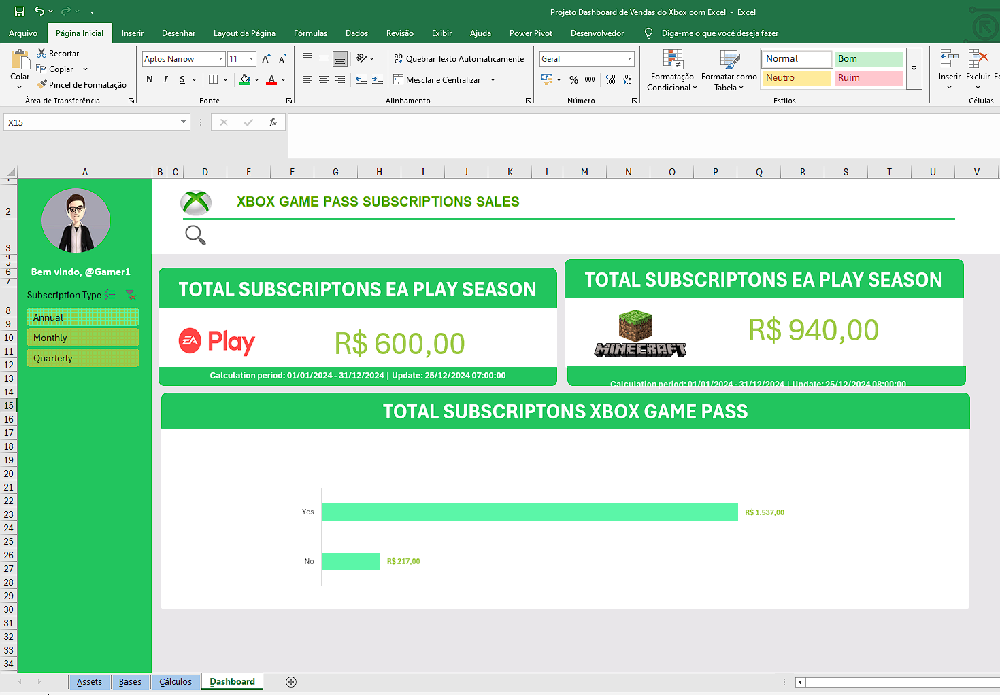
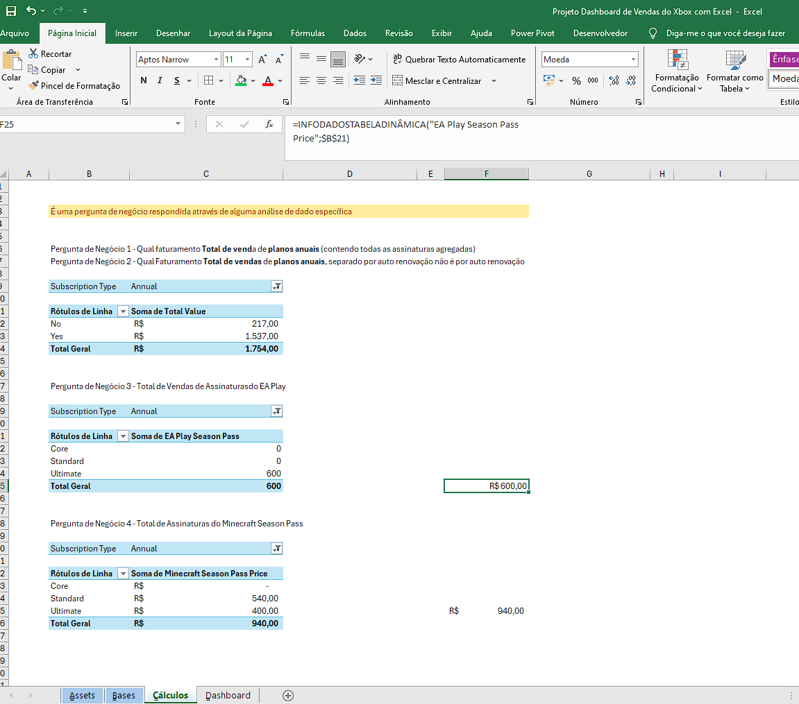
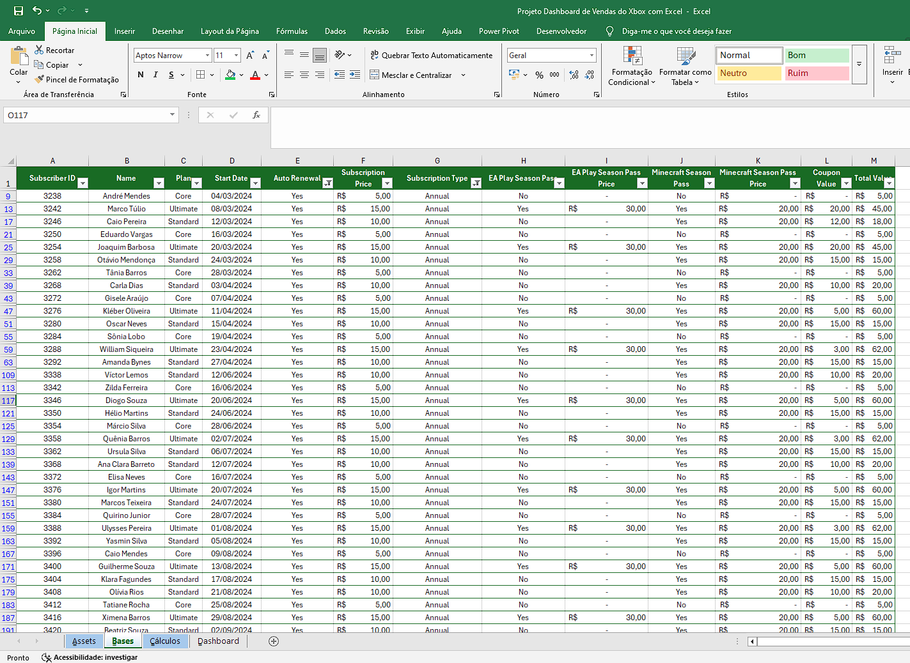
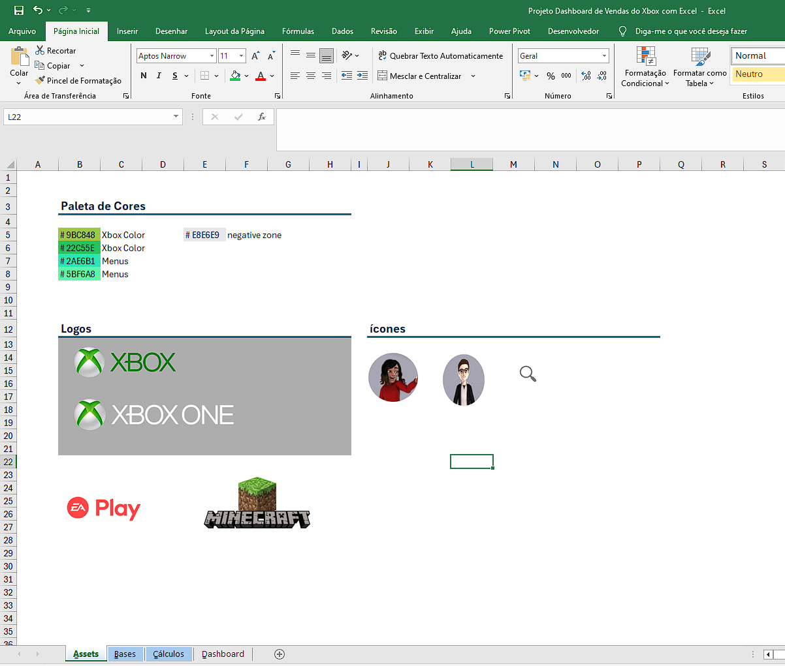
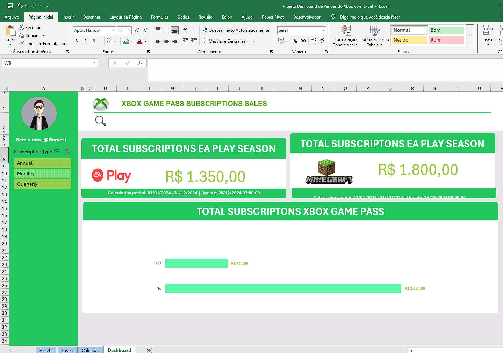
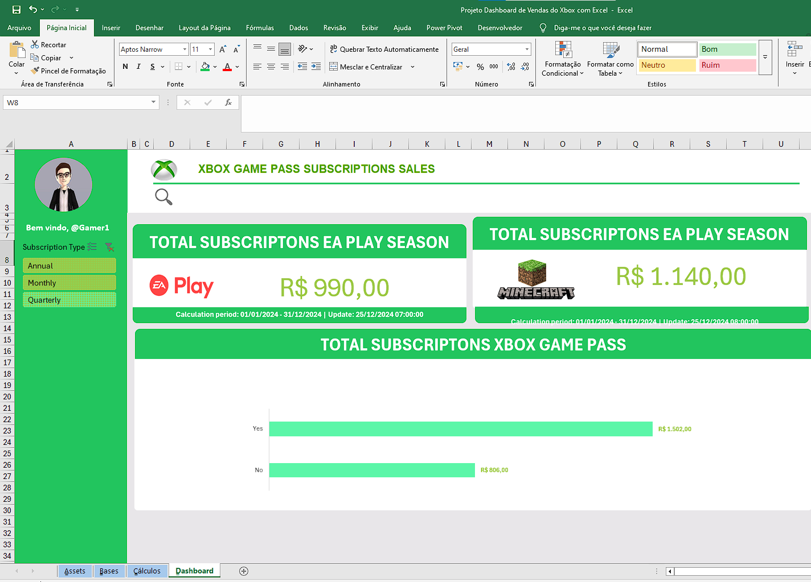

# 📊 Dashboard de Vendas do Xbox com Excel

## 📌 Sobre o Projeto

Este projeto consiste na criação de um **Dashboard de Vendas no Microsoft Excel**, desenvolvido como parte dos estudos em Análise e Visualização de Dados na plataforma [DIO.me](https://www.dio.me/).

O projeto foi desenvolvido com a orientação do professor **Felipe Aguiar (Felipão da DIO)**, com o objetivo de transformar dados brutos em informações visuais claras e úteis, facilitando a análise do desempenho de vendas e apoiando a tomada de decisões baseadas em dados.

Durante o desenvolvimento, foram utilizados recursos do Excel para organizar, resumir e visualizar as informações, com destaque para as Tabelas Dinâmicas, os gráficos e as segmentações de dados.

## 🎯 Objetivos do Projeto

- Organizar e analisar uma base de informações de vendas.
- Utilizar Tabelas Dinâmicas para resumir e consolidar os dados.
- Criar gráficos para facilitar a interpretação dos resultados.
- Aplicar segmentações de dados para permitir filtros interativos.
- Visualizar os valores de vendas em períodos anuais, trimestrais e mensais.
- Desenvolver um dashboard organizado e visualmente claro.

## 🛠️ Ferramentas e Recursos Utilizados

- **Microsoft Excel:** organização, análise e visualização dos dados.
- **Tabelas Dinâmicas:** resumo, agrupamento e consolidação das informações.
- **Gráficos:** representação visual dos resultados e comparação entre períodos.
- **Segmentações de Dados:** filtragem interativa das informações.
- **Formatação visual:** organização dos elementos para facilitar a leitura do dashboard.

## 📈 Funcionalidades do Dashboard

### 📅 Análise por Período

Os gráficos permitem visualizar os valores de vendas em diferentes períodos:

- **Anual:** análise dos resultados por ano.
- **Trimestral:** acompanhamento dos resultados por trimestre.
- **Mensal:** visualização dos resultados mês a mês.

Essa organização facilita a comparação entre períodos e a identificação de variações no desempenho das vendas.

### 🎛️ Segmentações de Dados

Foram utilizadas segmentações de dados para facilitar a filtragem das informações apresentadas nos gráficos.

Esse recurso permite interagir com os dados de acordo com os filtros disponíveis na planilha, tornando a análise mais dinâmica e prática.

### 📊 Visualização das Informações

Os gráficos e elementos visuais foram organizados para apresentar os resultados de forma clara, facilitando a leitura e a interpretação das informações de vendas.

## 🖼️ Demonstração Principal do Projeto

A imagem abaixo apresenta o dashboard principal desenvolvido no projeto.

Esta é a **única imagem utilizada como demonstração principal**. As demais imagens deste README são complementares e documentam partes da estrutura e do desenvolvimento do projeto.

## 🧮 Cálculos e Tabelas Dinâmicas

As Tabelas Dinâmicas foram utilizadas para resumir, agrupar e organizar os dados da base de vendas, contribuindo para a construção dos gráficos e a análise dos resultados.

## 🗃️ Base de Informações

A base de informações reúne os dados utilizados como origem para as análises e visualizações desenvolvidas no dashboard.

## 🎨 Assets do Projeto

Imagem complementar relacionada aos recursos visuais utilizados na construção e apresentação do projeto.

## 🔄 Variações do Dashboard

Durante o estudo, foram exploradas possibilidades de apresentação visual para o dashboard.

### Variação 1

### Variação 2

*As imagens desta seção são referências complementares. A demonstração principal do projeto continua sendo a imagem apresentada na seção anterior.*

## 🧩 Proposta do Desafio

O desafio consiste em criar um dashboard de vendas no Excel, com foco na organização e visualização de dados.

A proposta é transformar dados brutos em informações visuais claras e úteis, permitindo analisar o desempenho das vendas e contribuir para decisões baseadas em dados.

O projeto foi desenvolvido com essa finalidade, utilizando recursos do Excel para estruturar as informações e apresentá-las de maneira visual e organizada.

## 📚 Aprendizados

Durante o desenvolvimento do projeto, pratiquei:

- Organização e estruturação de dados no Excel.
- Criação e utilização de Tabelas Dinâmicas.
- Construção de gráficos para análise de resultados.
- Aplicação de segmentações de dados para filtros interativos.
- Visualização de informações em períodos anuais, trimestrais e mensais.
- Organização visual de dashboards para facilitar a interpretação dos dados.

## 📥 Como Acessar o Projeto

Para visualizar e explorar o dashboard:

1. Baixe a planilha Excel pelo link abaixo.
2. Salve o arquivo em seu computador.
3. Abra a planilha no Microsoft Excel.
4. Explore o dashboard, os gráficos, as Tabelas Dinâmicas e as segmentações de dados disponíveis.

**[📥 Baixar Dashboard de Vendas do Xbox em Excel](./Projeto%20Dashboard%20de%20Vendas%20do%20Xbox%20com%20Excel.xlsx)**

## 👨‍💻 Autor

**Jesse Alves**

Estudante de Análise e Desenvolvimento de Sistemas, em transição de carreira para a área de Dados e Tecnologia.

🔗 **GitHub:** [jessealves-jpg](https://github.com/jessealves-jpg)

## 🎓 Créditos

Projeto educacional desenvolvido como parte dos estudos em Análise e Visualização de Dados na plataforma [DIO.me](https://www.dio.me/), com orientação do professor **Felipe Aguiar (Felipão da DIO)**.

---

*Projeto desenvolvido para fins de aprendizado e prática de análise e visualização de dados utilizando o Microsoft Excel.*
